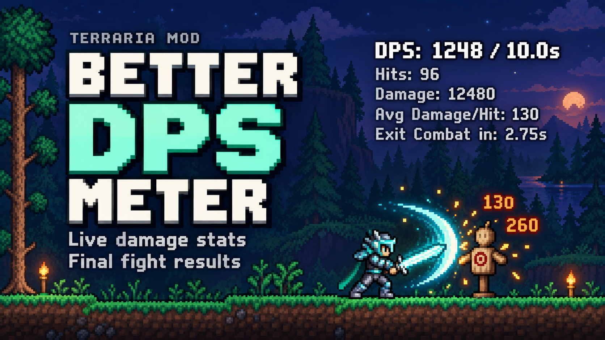

# Better DPS Meter



**Track recent combat damage with a configurable DPS overlay.**

Better DPS Meter adds a configurable combat overlay that tracks the local player's recent damage and displays a rolling DPS value during combat.

The overlay can also show hit count, total damage, average damage per hit, combat timeout, and the final result of the completed combat session. By default, the vanilla DPS Meter effect is required to record hits and show the overlay.

## Features

- Display rolling average DPS for the local player.
- Optionally show hits, total damage, and average damage per hit.
- Keep the final full-session combat result visible after combat ends.
- Configure the DPS averaging window.
- Configure how long the tracker remains in combat after the last hit.
- Optionally track hits and show the overlay without the vanilla DPS Meter effect.

## How it works

During combat, damage reported for the local player is accumulated in a configurable rolling time window. The live DPS, hit count, and damage values are calculated from the damage currently inside that window.

Combat remains active for a configurable period after the last recorded hit. When that timeout expires, Better DPS Meter replaces the rolling values with a final aggregate for the completed combat session. Final DPS uses the full session damage over the elapsed gameplay time from the first accepted hit to the last accepted hit, so the post-hit combat timeout does not reduce the final result.

The overlay is hidden in the main menu, while the game is paused, and while the inventory or full-screen map is open. While gameplay continues behind the inventory or map, the tracker keeps counting hits and updating the combat timeout. When you close the inventory or map, the overlay shows the current stats or the final result if combat has ended.

At a width of 1024 UI units or less (after UI scaling), the overlay lines up with the left edge of the buff icons, above the chat. It reserves space for all five HUD lines and the ten visible chat lines, so its position stays stable as messages fade or combat ends. Wider layouts use the original position near the top of the screen.

If the gap between the buff timers and chat is too short for five lines, the overlay returns to its top position and can overlap the health display. At 800×600 and 100% UI scale, three rows of buffs fit. A fourth row (34 or more active buffs) moves the overlay to the top.

## Settings

Press **F6** and select **Better DPS Meter** to open its settings.

- **Show Extra Info** — shows the time span used for DPS, hit count, total damage, average damage per hit, and a countdown while combat is active. Enabled by default. The final **Combat Ended** label is visible with either setting.
- **Require DPS Meter** — requires the accessory effect to record hits and show the overlay. If you gain the effect mid-fight, tracking starts with your next hit. Enabled by default.
- **DPS Window (seconds)** — controls how many seconds of recent damage are used for the live DPS calculation. Range: 2–60 seconds. Default: 10.
- **Combat Timeout (seconds)** — controls how long after the last hit the tracker is still considered in combat. Range: 0.5–30 seconds. Default: 3.0.

## Requirements

- **Terraria 1.4.6** for Windows.
- **TerrariaModder Core 0.4.3 or newer.** Choose a compatible Core release from [Nexus Mods](https://www.nexusmods.com/terraria/mods/135?tab=files) or [GitHub Releases](https://github.com/Inidar1/terraria-modder/releases).
- [.NET Framework 4.8 Runtime](https://dotnet.microsoft.com/en-us/download/dotnet-framework/net48).

## Installation

1. Close Terraria and install any missing dependencies listed under [Requirements](#requirements). For a manual TerrariaModder Core installation, extract the Core archive into the folder containing `Terraria.exe`.
2. Download the Better DPS Meter archive for your Terraria version.

   - On [Nexus Mods](https://www.nexusmods.com/terraria/mods/166?tab=files), select **Manual download** for the main file.
   - On the [latest GitHub release](https://github.com/EscarvalOokt/BetterDPSMeter/releases/latest), download the packaged mod from **Assets**.

3. In your Terraria installation folder, open `TerrariaModder\mods\`. Create the `mods` folder if needed.
4. Open the mod archive and copy its `better-dps-meter` folder into `mods`. When updating, replace the existing `BetterDPSMeter.dll` and `manifest.json` with the copies from the new archive.
5. Run `TerrariaInjector.exe` from the folder containing `Terraria.exe`, or launch the modded game from TerrariaModder Vault.
6. Enter a world with the vanilla DPS Meter effect active and hit an enemy. The overlay shows your current DPS. With the default settings, **Combat Ended** and the final DPS appear after three seconds of gameplay without another hit.

After installation, the mod files should be in the following locations.

```text
Terraria\
├── Terraria.exe
├── TerrariaInjector.exe
└── TerrariaModder\
    └── mods\
        └── better-dps-meter\
            ├── BetterDPSMeter.dll
            └── manifest.json
```

## Compatibility

### Existing characters and worlds

You can use Better DPS Meter with an existing character and world.

### Removing the mod

Close Terraria and remove the `better-dps-meter` folder from `TerrariaModder\mods\`. You can continue playing with the same character and world without save cleanup.

### Multiplayer

Better DPS Meter is a client-only mod. The overlay tracks damage for your local character. Multiplayer behavior has not been separately verified.

### Saved progress

Combat statistics stay in memory while you are in the world. Leaving the world clears the current fight and the last combat result. TerrariaModder saves your mod settings.

### Other mods

Better DPS Meter counts damage that Terraria reports to its built-in DPS meter. Damage from a mod that bypasses that mechanism may be missing from the overlay.

## Technical documentation

- [Development guide](docs/development.md)
- [Architecture](docs/architecture.md)
- [Testing policy](docs/testing.md)